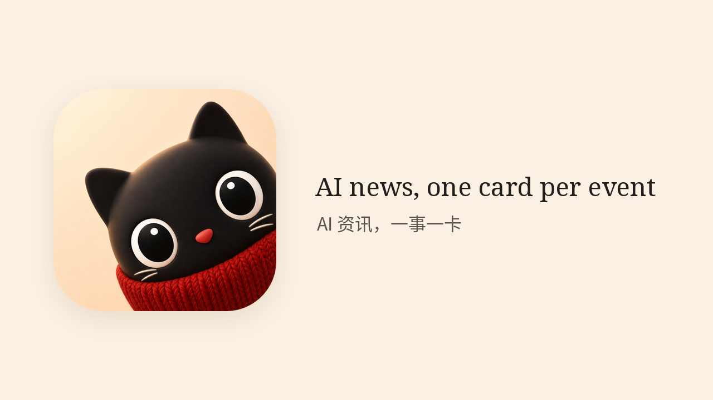
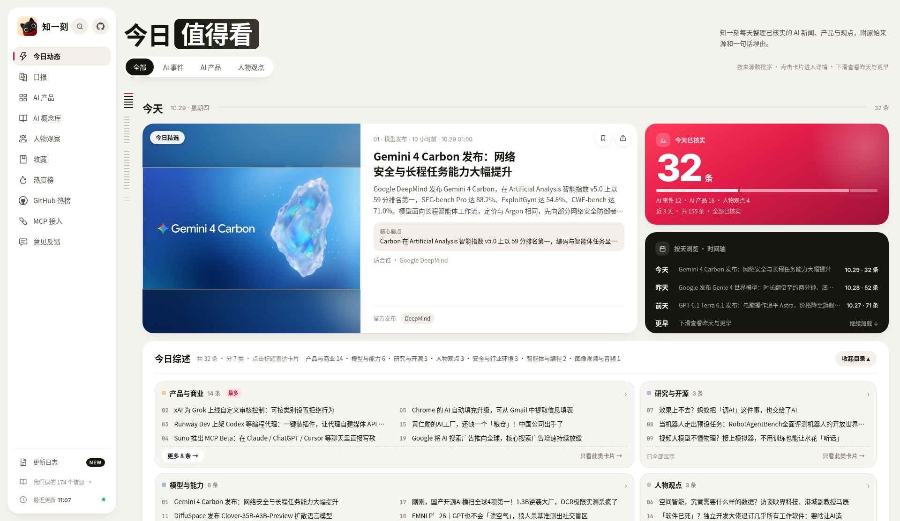
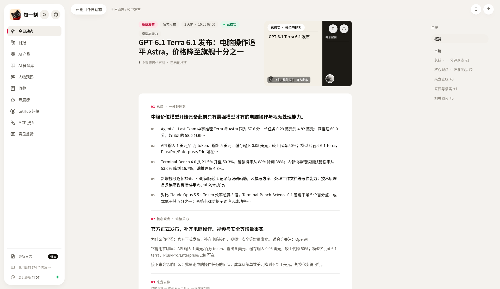
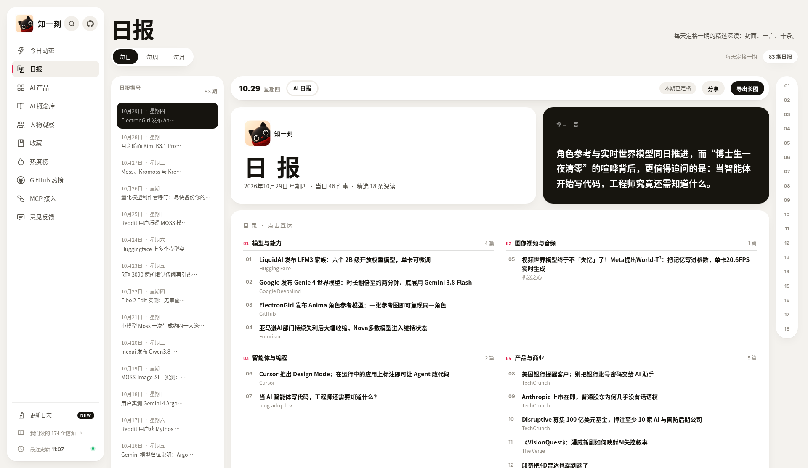
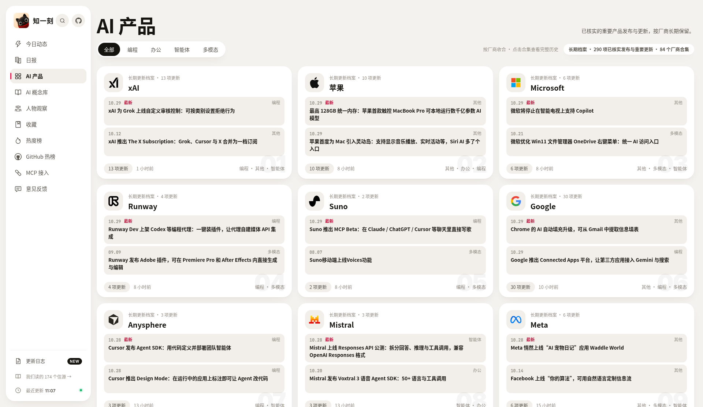

<p align="center">
  
</p>

<p align="center">
  <a href="docs/readme/banner-dark.jpg">Dark banner</a>
  · <a href="docs/readme/logo-3d-solid.png">3D solid mark</a>
</p>

<!-- GitHub README does not play inline video, so the GIF is the visible preview and the MP4 is the primary file. -->

<p align="center">
  <a href="docs/readme/zhiyike-connect-silent-demo.mp4">
    
  </a>
</p>

<p align="center">
  <a href="docs/readme/zhiyike-connect-silent-demo.mp4">Silent demo</a> · 19.6s · no audio · 1280×720
</p>

**Zhiyike (知一刻)** is a free, read-only desk for verified Chinese AI news: one card per real event, with sources kept. Use the site, the remote MCP, the Skill, or RSS. No account and no API key.

[Site](https://zhiyike.cn/) · [MCP](https://zhiyike.cn/mcp) · [Skill](https://zhiyike.cn/skills/install.html) · [RSS](https://zhiyike.cn/rss.xml) · [License](LICENSE)

[](https://github.com/biletian/zhiyike-connect/stargazers)
[](https://glama.ai/mcp/connectors/cn.zhiyike/zhiyike)
[](https://registry.modelcontextprotocol.io/v0.1/servers?search=io.github.biletian/zhiyike)
[](LICENSE)
[](https://github.com/biletian/zhiyike-connect/releases/latest)

## Install in one copy

### MCP

`https://zhiyike.cn/mcp` · Streamable HTTP · no API key

```json
{
  "mcpServers": {
    "zhiyike": {
      "url": "https://zhiyike.cn/mcp"
    }
  }
}
```

If the client requires a transport, add `"type": "http"` on that server (Streamable HTTP, not SSE). Claude Code:

```bash
claude mcp add --transport http zhiyike https://zhiyike.cn/mcp
```

> 请帮我添加并连接知一刻只读 MCP，地址：https://zhiyike.cn/mcp，连接方式：Streamable HTTP。
>
> 复制即可。保存地址不算接通，客户端列出六个只读工具才算连上。

The site name is `知一刻内容`. A saved URL is connected only when the client lists the six read-only tools.

### Skill

The Skill does not edit your MCP config. It needs Python 3.10+ and network access to `https://zhiyike.cn`.

Packaging release **v1.2.5**. The zip bytes are unchanged from v1.2.4.

- Install guide: <https://zhiyike.cn/skills/install.html>
- Zip: <https://zhiyike.cn/skills/zhiyike-reader.zip>
- Release asset: <https://github.com/biletian/zhiyike-connect/releases/download/v1.2.5/zhiyike-reader.zip>
- SHA-256: `78b91793e3fd971e151d332cbd453ce205dcab470f2e43bbe5149b44de8d120f` (8149 bytes)

The file under `skill/download/` is an older mirror. Install the official zip or the v1.2.5 Release asset.

### RSS

<https://zhiyike.cn/rss.xml> · GitHub mirror: <https://raw.githubusercontent.com/biletian/zhiyike-connect/main/rss.xml>

## What you get

- **One card per event.** Many outlets covering one story become one card, and the sources stay on it.
- **A desk you can finish.** Verified events, product updates, and a daily or weekly report that keeps its date.
- **A product library.** Public AI products and their updates stay after the news scroll moves on.
- **Read-only doors.** The site, MCP, Skill, and RSS serve that same public feed. No account and no API key.

### 中文

- **一事一卡。** 同一事件合并，来源留在卡上。
- **当天的事，一张卡看懂。** 已核实的动态、产品更新，以及标日期的日报和周报。
- **产品库会留下。** 公开产品与重要更新不随新闻流消失。
- **只读，不要密钥。** 网站、MCP、Skill、RSS 读同一套已公开内容。

## Features

<p align="center">
  
</p>

Today's verified feed: one card per event, with sources kept.

<p align="center">
  
</p>

A story card: the claim, the sources, and a one-minute read.

<p align="center">
  
</p>

The daily issue keeps its date and its edition number.

<p align="center">
  
</p>

The product library keeps updates on the product, not only in the news scroll.

## How it works

Public items pass a short gate. Candidates come from public sites and feeds, and only AI-related ones stay. The body is checked against the source. The same event is merged into one card; a new source adds a fact or only another citation. Failed reads and conflicts stay internal, off the site, MCP, Skill, and RSS. Those doors are read-only: they cannot edit the feed, see accounts, or start a model run.

### 中文

公开来源里收集候选，读正文，核对时间和关键事实。
同一件事并成一张卡；没通过核实的不进入公开页。
MCP、Skill 和 RSS 只读这套内容，不能改，也不能看账号。

## Tools

| Tool | One line | Access |
| --- | --- | --- |
| `list_news` | Published news by date or keyword. | read-only |
| `get_news_detail` | One story plus its sources. | read-only |
| `search_library` | Public AI products or concepts. | read-only |
| `list_reports` | Daily and weekly report index. | read-only |
| `get_report` | One daily or weekly issue. | read-only |
| `github_trending` | Saved GitHub AI day or week snapshot. | read-only |

## Links

- Site: <https://zhiyike.cn/>
- MCP Registry: <https://registry.modelcontextprotocol.io/v0.1/servers?search=io.github.biletian/zhiyike> (`io.github.biletian/zhiyike`)
- Glama: <https://glama.ai/mcp/connectors/cn.zhiyike/zhiyike>
- Release v1.2.5: <https://github.com/biletian/zhiyike-connect/releases/tag/v1.2.5>
- Skill zip: <https://zhiyike.cn/skills/zhiyike-reader.zip> · <https://github.com/biletian/zhiyike-connect/releases/download/v1.2.5/zhiyike-reader.zip> · SHA-256 `78b91793e3fd971e151d332cbd453ce205dcab470f2e43bbe5149b44de8d120f`

## Star history

[](https://www.star-history.com/#biletian/zhiyike-connect&Date)

## Related · 相关

- [awesome-ai-news-sources-zh](https://github.com/biletian/awesome-ai-news-sources-zh) — 中文 AI 资讯信源清单 · Curated AI news sources read daily by Zhiyike (CC0)
- [Showcase page · 展示页](https://biletian.github.io/zhiyike-connect/)
